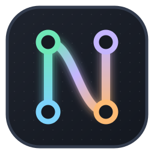
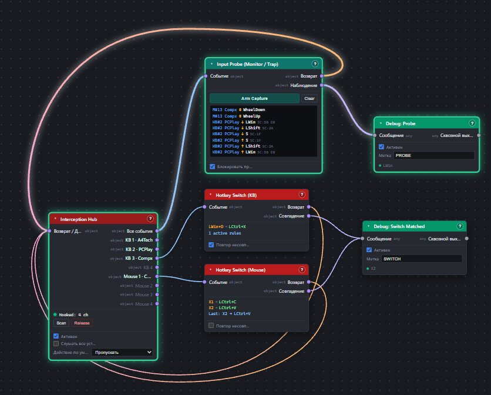

<p align="center">
  
</p>

<h1 align="center">NaSeqMen</h1>

<p align="center">
  <strong>Visual node-flow router for hardware input, hotkeys, OBS Studio, windows, and live C# scripts.</strong>
</p>

<p align="center">
  English | <a href="README.ru.md">Русский</a>
</p>

---

**Connect keyboards, mice, macro pads, OBS Studio, desktop windows, and C# scripts like patch cables — and watch every signal travel live.**

NaSeqMen combines the tactile visual canvas of a Blender node editor with the reactive message routing of Node-RED, running natively on **.NET 11** right from your Windows system tray. No proprietary hardware lock-in, no giant config files: pick any connected device, wire its events to switches, filters, virtual sliders, or scripts, and hit **Deploy**.



---

## Why NaSeqMen?

- **Per-device hardware control:** Intercept a second keyboard, barcode scanner, or specific mouse (`X1`/`X2` side buttons, chords like `LWin+D → LCtrl+X`, multi-step sequences like `LCtrl+K, LCtrl+D`) without touching your primary keyboard.
- **Zero-guesswork Input Probe:** Arm a safe capture trap with live key/button readout so you see *exactly* what each button sends before mapping it — with instant **`Esc`** disarm, inactivity auto-off, and a hard safety timeout.
- **Interactive studio widgets right on the canvas:** Toggle buttons, faders, live stereo OBS **VU meters**, and hardware device checklists sit directly inside your flow graph.
- **Real C# whenever you need custom logic:** Drop a **C# Function** node (Roslyn-compiled on deploy) to inspect, transform, suppress, or synthesize any event in a few lines of C#.
- **Self-documenting & multilingual:** Every node has a `?` button opening rich Markdown documentation (purpose, scenarios, ports, setup tips) in your language — plus localized parameters and instant language switching.
- **True plugin architecture:** Add new integrations by dropping a folder into `plugins/` — the host discovers and loads them dynamically with zero recompilation.

---

## Built-in Modules & Plugins

| Module / Plugin | Kind | Nodes | Highlights |
| --- | --- | --- | --- |
| `NaSeqMen.Nodes.Basic` | Core | `Keyboard Input`, `CAPS (ToUpper)`, `Keyboard Output`, `Debug` | Global Raw Input listener (EN/RU layouts), Unicode `SendInput`, live Debug stream |
| `NaSeqMen.Nodes.Controls` | Core | `Virtual Button`, `Virtual Slider`, `VU Meter` | Momentary/toggle buttons, two-way feedback sliders, stereo peak-hold VU meters |
| `NaSeqMen.Nodes.Scripting` | Core | `C# Function` | Pre-compiled Roslyn C# scripts with per-node `state`, `Suppress()`, `SendKeys()`, `SendMouse()` |
| `NaSeqMen.Nodes.Interception` | Plugin | `Interception Hub`, `Interception Device`, `Hotkey Switch`, `Input Probe`, `Stroke Action`, `Chord Matcher` | Hardware-level per-device loop-back hooks, friendly USB brand/model names, unified modifier buffering & replay, panic release (`Ctrl+Alt+Pause`) |
| `NaSeqMen.Nodes.Obs` | Plugin | `OBS Studio` | Native OBS WebSocket v5 client (SHA-256 auth, scenes, volume/mute, recording/streaming, real-time `InputVolumeMeters`) |
| `NaSeqMen.Nodes.Windows` | Plugin | `Window Filter`, `Focus Window`, `Window PostText` | Foreground window routing, window activation, background `WM_CHAR` posting |

---

## Quick Start

### Requirements

- **Windows 10 / 11 (x64)**
- **.NET 11 SDK** (`dotnet --version`)
- *(Optional)* **Interception driver** (`interception.dll`) if you want hardware-level per-device interception — NaSeqMen runs cleanly without it and auto-discovers it at runtime when installed.

### Build & Run

```powershell
git clone https://github.com/NaBrIks/NaSeqMen.git
cd NaSeqMen

# Build the solution (core + host + dynamically staged plugins)
dotnet build src\NaSeqMen.slnx

# Launch the tray host and open the editor at http://127.0.0.1:17980
.\Start-NaSeqMen-V2.cmd
```

Or run the host directly from the terminal:

```powershell
dotnet run --project src\NaSeqMen.Host\NaSeqMen.Host.csproj
```

Then open **http://127.0.0.1:17980** in any modern browser. Use the tray icon (Neon N-Curve) to open the editor, pause/resume the engine, or exit cleanly.

---

## Optional: Installing the Interception Driver (Per-Device Hardware Hooks)

All basic input, virtual controls, OBS Studio, Windows filters, and C# scripts work out of the box without any driver. If you want **hardware-level per-device interception and suppression** (e.g. remapping a second keyboard or side mouse buttons `X1`/`X2` via `Interception Hub`), install the official third-party [oblitum/Interception](https://github.com/oblitum/Interception) driver:

1. **Download** the latest `Interception.zip` archive from the official releases page:
   `https://github.com/oblitum/Interception/releases`
2. **Extract** it to a clean folder, for example `C:\Interception`.
3. **Install the driver** from an **Administrator** Command Prompt (`cmd.exe` → *Run as administrator*):
   ```cmd
   cd "C:\Interception\command line installer"
   install-interception.exe /install
   ```
4. **Reboot Windows** (required once for the kernel filter driver to activate).
5. **Make `interception.dll` (64-bit `library\x64\interception.dll`) available to NaSeqMen** — pick **any one** option:
   - **Drop into the plugin folder (recommended):** copy `library\x64\interception.dll` into `plugins\NaSeqMen.Nodes.Interception\interception.dll` (next to `NaSeqMen.Nodes.Interception.dll`), or next to `NaSeqMen.Host.exe`.
   - **Standard folder auto-detect:** leave the archive extracted at `C:\Interception\library\x64\interception.dll` (or `%ProgramFiles%\Interception\library\x64\interception.dll`).
   - **Environment variable:** set `NASEQMEN_INTERCEPTION_DLL=C:\path\to\interception.dll`.
   - **Per-node setting:** paste the full path into **DLL Path** in the `Interception Hub` Inspector.
6. **To uninstall later** (Administrator Command Prompt + reboot):
   ```cmd
   cd "C:\Interception\command line installer"
   install-interception.exe /uninstall
   ```

> **Note:** `oblitum/Interception` is an independent external driver (free for non-commercial use under LGPL-3.0; commercial use requires a commercial license from its author). NaSeqMen never bundles or installs it automatically. See [THIRD_PARTY_NOTICES.md](THIRD_PARTY_NOTICES.md).

---

## Technical Details

### Architecture

```text
src/
  NaSeqMen.Core/                Pure SDK contracts (FlowMessage, INode, INodePlugin, descriptors)
  NaSeqMen.Engine/              FlowEngine, NodeRegistry, PluginLoader (AssemblyLoadContext), NodeLocalizationService
  NaSeqMen.Host/                ASP.NET Core loopback API + SSE + Windows Tray host + pure HTML/CSS/JS editor
  NaSeqMen.Nodes.Basic/         Built-in starter I/O & Debug nodes
  NaSeqMen.Nodes.Controls/      Built-in interactive UI widgets & meters
  NaSeqMen.Nodes.Scripting/     Built-in Roslyn C# Function node
  NaSeqMen.Nodes.Interception/  External dynamic plugin -> plugins/NaSeqMen.Nodes.Interception/
  NaSeqMen.Nodes.Obs/           External dynamic plugin -> plugins/NaSeqMen.Nodes.Obs/
  NaSeqMen.Nodes.Windows/       External dynamic plugin -> plugins/NaSeqMen.Nodes.Windows/
  NaSeqMen.Tests/               Automated test runner (26 end-to-end & unit tests)
```

- **Data Basket Paradigm:** Every event travels as a `FlowMessage` basket (`Payload`, `Topic`, `Properties`, `OriginNodeId`). Loop-back flows (e.g. `Interception Hub → Hotkey Switch / Input Probe → Return / Action`) correlate decisions by `correlationId` and merge parallel branches safely before releasing or suppressing a hardware stroke.
- **Plugin Isolation:** `NaSeqMen.Host` has zero compile-time or runtime project references to external plugins. Plugins are built with `EnableDynamicLoading=true`, staged to `plugins/<PluginName>/`, and loaded into isolated `AssemblyLoadContext` instances sharing `NaSeqMen.Core`.
- **Hybrid N-Language Localization & Docs:**
  - Every module/plugin keeps its own `locales/<lang>/strings.json` and `locales/<lang>/<typeId>.md`.
  - Lookup priority: `locales-override/<lang>/` → external `locales/<lang>/` next to the DLL → embedded assembly resources (for single-DLL third-party plugins) → `en` fallback → auto-generated Markdown from C# metadata.
  - Drop a new language folder (e.g. `de/`, `ja/`) or edit any `.md` file and click `↻` in the **Help** tab — zero rebuild or restart required.

### Environment Variables

| Variable | Default | Purpose |
| --- | --- | --- |
| `NASEQMEN_PORT` | `17980` | Local HTTP/SSE loopback port |
| `NASEQMEN_PLUGINS_DIR` | `<AppDir>\plugins` | External plugin discovery directory |
| `NASEQMEN_INTERCEPTION_DLL` | Auto-detect | Explicit path to `interception.dll` |

### Automated Tests

```powershell
dotnet run --project src\NaSeqMen.Tests\NaSeqMen.Tests.csproj
```

Covers hardware HWID resolution across USB slot changes, loop-back chord suppression & atomic modifier replay, `Input Probe` failsafes, mock OBS WebSocket v5 auth & VU meters, Roslyn C# script isolation, dynamic `PluginLoader` discovery, and hybrid EN/RU + third-party localization/docs fallback.

---

## Safety & Licenses

- **Emergency hardware release:** Pressing **`Ctrl + Alt + Pause`** (or clicking **Release** on the Interception node) immediately clears all Interception driver filters so you can never lock yourself out of keyboard or mouse input.
- **No bundled drivers or autostart:** NaSeqMen never bundles `interception.dll`, never installs kernel drivers, and never registers Windows autostart.
- **License:** Original source code is licensed under **[MIT](LICENSE)**. All bundled/NuGet dependencies (`.NET 11`, Roslyn `Microsoft.CodeAnalysis.CSharp.Scripting`) are MIT-licensed; the USB vendor lookup table is used under **3-Clause BSD** (`usb.ids`). Full attribution and optional Interception license details are in [THIRD_PARTY_NOTICES.md](THIRD_PARTY_NOTICES.md).
