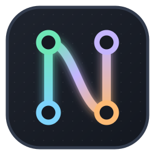
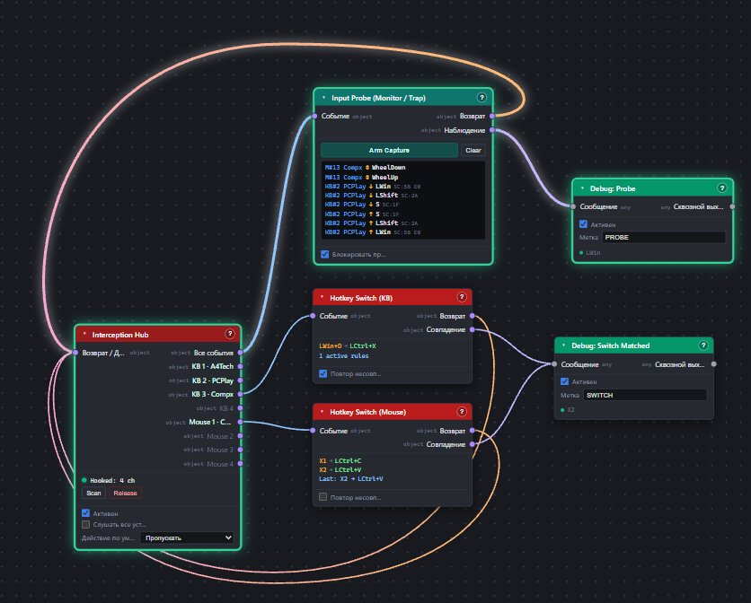

<p align="center">
  
</p>

<h1 align="center">NaSeqMen</h1>

<p align="center">
  <strong>Визуальный узловой коммутатор для клавиатур, мышей, хоткеев, OBS Studio, окон Windows и C#-скриптов.</strong>
</p>

<p align="center">
  <a href="README.md">English</a> | Русский
</p>

---

**Соединяйте клавиатуры, мыши, макропады, OBS Studio, окна Windows и C#-скрипты как кабели на модульном синтезаторе — и наблюдайте прохождение сигналов в реальном времени.**

NaSeqMen объединяет удобный визуальный холст в духе Blender и событийную маршрутизацию в стиле Node-RED. Работает нативно на **.NET 11** из системного трея Windows, не привязан к конкретным моделям устройств и не требует ручной правки конфигов: выберите подключённое железо галочкой, протяните связи к переключателям, фейдерам или скриптам и нажмите **Применить (`Deploy`)**.



---

## Что можно собрать за пару минут?

- **Перехват по конкретному устройству:** переназначьте кнопки второй клавиатуры, сканера или боковые кнопки конкретной мыши (`X1`/`X2`, аккорды вида `LWin+D → LCtrl+X`, последовательности `LCtrl+K, LCtrl+D`), не затрагивая основную клавиатуру.
- **Безопасный «зонд» ввода (`Input Probe`):** нажмите `Arm Capture`, чтобы в живом мини-терминале увидеть *точные* коды нажатых кнопок без случайного срабатывания действий в Windows — с мгновенным выходом по **`Esc`**, авто-отключением по простою и жёстким лимитом времени.
- **Интерактивные виджеты прямо на схеме:** кнопки (мгновенные и с фиксацией), слайдеры с обратной связью, живые стерео **VU-метры** из OBS и наглядный список подключённых устройств с фирменными именами.
- **Полноценный C# там, где нужна своя логика:** узел **C# Function** компилируется через Roslyn при деплое и позволяет в несколько строк проверять, менять, подавлять или отправлять любые нажатия.
- **Встроенная справка `?` на каждый узел:** прямо в заголовке узла, в палитре и во вкладке **Инфо** есть кнопка `?`, открывающая подробную Markdown-документацию (назначение, сценарии, порты, настройка) с переключением языка на лету.
- **Честная система плагинов:** подключайте новые интеграции просто добавив папку в `plugins/` — исполнитель находит и загружает их динамически без пересборки ядра.

---

## Встроенные модули и плагины

| Модуль / Плагин | Тип | Узлы | Возможности |
| --- | --- | --- | --- |
| `NaSeqMen.Nodes.Basic` | Ядро | `Keyboard Input`, `CAPS (ToUpper)`, `Keyboard Output`, `Debug` | Глобальный перехват Raw Input (раскладки EN/RU), ввод Unicode через `SendInput`, живая панель отладки |
| `NaSeqMen.Nodes.Controls` | Ядро | `Virtual Button`, `Virtual Slider`, `VU Meter` | Кнопки (`Momentary` / `Toggle`), слайдеры с синхронизацией состояния, стерео VU-метры с пик-холдом |
| `NaSeqMen.Nodes.Scripting` | Ядро | `C# Function` | Предкомпилируемые Roslyn C#-скрипты с локальным `state`, `Suppress()`, `SendKeys()`, `SendMouse()` |
| `NaSeqMen.Nodes.Interception` | Плагин | `Interception Hub`, `Interception Device`, `Hotkey Switch`, `Input Probe`, `Stroke Action`, `Chord Matcher` | Аппаратный перехват по конкретным устройствам, распознавание USB-брендов, буферизация и возврат несовпавших модификаторов, аварийный сброс (`Ctrl+Alt+Pause`) |
| `NaSeqMen.Nodes.Obs` | Плагин | `OBS Studio` | Нативный клиент OBS WebSocket v5 (SHA-256 авторизация, сцены, громкость/мьют, запись/стрим, живые `InputVolumeMeters`) |
| `NaSeqMen.Nodes.Windows` | Плагин | `Window Filter`, `Focus Window`, `Window PostText` | Фильтрация по активному окну, активация окна, фоновая отправка текста (`WM_CHAR`) |

---

## Быстрый старт

### Требования

- **Windows 10 / 11 (x64)**
- **.NET 11 SDK** (`dotnet --version`)
- *(Опционально)* драйвер **Interception** (`interception.dll`) для аппаратного перехвата по конкретным устройствам — без него всё остальное работает штатно, а при наличии DLL подхватывается автоматически.

### Сборка и запуск

```powershell
git clone https://github.com/NaBrIks/NaSeqMen.git
cd NaSeqMen

# Сборка решения (ядро + хост + автоматическая укладка плагинов в plugins/)
dotnet build src\NaSeqMen.slnx

# Запуск исполнителя в трее и открытие редактора http://127.0.0.1:17980
.\Start-NaSeqMen-V2.cmd
```

Либо запуск напрямую из консоли:

```powershell
dotnet run --project src\NaSeqMen.Host\NaSeqMen.Host.csproj
```

Откройте **http://127.0.0.1:17980** в любом современном браузере. Через иконку в системном трее (неоновая **N**-кривая) можно открыть редактор, поставить движок на паузу или завершить работу.

---

## Опционально: установка драйвера Interception (перехват по устройствам)

Базовый ввод, виртуальные контролы, OBS Studio, фильтры окон и C#-скрипты работают сразу «из коробки» без каких-либо драйверов. Если нужен **аппаратный перехват и подавление по конкретному устройству** (например, переназначение отдельной второй клавиатуры или боковых кнопок мыши `X1`/`X2` через `Interception Hub`), установите официальный внешний драйвер [oblitum/Interception](https://github.com/oblitum/Interception):

1. **Скачайте** свежий архив `Interception.zip` со страницы официальных релизов:
   `https://github.com/oblitum/Interception/releases`
2. **Распакуйте** его, например, в `C:\Interception`.
3. **Установите драйвер** через Командную строку **от имени администратора** (`cmd.exe` → *Запуск от имени администратора*):
   ```cmd
   cd "C:\Interception\command line installer"
   install-interception.exe /install
   ```
4. **Перезагрузите Windows** (нужно один раз, чтобы драйвер фильтра загрузился).
5. **Укажите NaSeqMen, где лежит 64-битная `library\x64\interception.dll`** — достаточно **любого одного** способа:
   - **Положить в папку плагина (проще всего):** скопируйте `library\x64\interception.dll` в `plugins\NaSeqMen.Nodes.Interception\interception.dll` (рядом с `NaSeqMen.Nodes.Interception.dll`) либо рядом с `NaSeqMen.Host.exe`.
   - **Автопоиск по стандартному пути:** просто оставьте распакованный архив в `C:\Interception\library\x64\interception.dll` (или `%ProgramFiles%\Interception\library\x64\interception.dll`).
   - **Переменная среды:** задайте `NASEQMEN_INTERCEPTION_DLL=C:\путь\к\interception.dll`.
   - **Прямо в редакторе:** укажите путь в параметре **Путь к DLL (`DLL Path`)** в Инспекторе узла `Interception Hub`.
6. **Удаление драйвера** (если когда-нибудь понадобится — от имени администратора + перезагрузка):
   ```cmd
   cd "C:\Interception\command line installer"
   install-interception.exe /uninstall
   ```

> **Лицензия драйвера:** `oblitum/Interception` — внешний драйвер (бесплатен для некоммерческого использования по LGPL-3.0; коммерческое использование требует отдельной коммерческой лицензии у автора). NaSeqMen не включает его в поставку и не ставит автоматически. Подробности — в [THIRD_PARTY_NOTICES.md](THIRD_PARTY_NOTICES.md).

---

## Технические нюансы

### Структура решения

```text
src/
  NaSeqMen.Core/                Контракты SDK (FlowMessage, INode, INodePlugin, дескрипторы)
  NaSeqMen.Engine/              FlowEngine, NodeRegistry, PluginLoader (AssemblyLoadContext), NodeLocalizationService
  NaSeqMen.Host/                Локальный ASP.NET Core API + SSE + иконка трея + HTML/CSS/JS редактор
  NaSeqMen.Nodes.Basic/         Базовый ввод/вывод и отладка
  NaSeqMen.Nodes.Controls/      Интерактивные контролы и индикаторы
  NaSeqMen.Nodes.Scripting/     Roslyn C#-скриптинг
  NaSeqMen.Nodes.Interception/  Внешний плагин -> plugins/NaSeqMen.Nodes.Interception/
  NaSeqMen.Nodes.Obs/           Внешний плагин -> plugins/NaSeqMen.Nodes.Obs/
  NaSeqMen.Nodes.Windows/       Внешний плагин -> plugins/NaSeqMen.Nodes.Windows/
  NaSeqMen.Tests/               Автотесты (26 модульных и интеграционных проверок)
```

- **Парадигма «корзинки данных»:** каждое событие проходит по графу в объекте `FlowMessage` (`Payload`, `Topic`, `Properties`, `OriginNodeId`). В схемах с петлёй возврата (`Interception Hub → Hotkey Switch / Input Probe → Возврат / Действие`) решения связываются по `correlationId` и безопасно объединяются из параллельных веток до пропуска или подавления сигнала.
- **Изоляция плагинов:** `NaSeqMen.Host` не имеет ссылок времени компиляции на внешние плагины. Плагины собираются с `EnableDynamicLoading=true`, укладываются сборщиком в `plugins/<ИмяПлагина>/` и загружаются в изолированный `AssemblyLoadContext` с общим `NaSeqMen.Core`.
- **Гибридная N-язычная локализация и документация:**
  - У каждого модуля и плагина своя папка `locales/<lang>/strings.json` и `locales/<lang>/<typeId>.md`.
  - Приоритет загрузки: `locales-override/<lang>/` → внешняя папка `locales/<lang>/` рядом с DLL → встроенные ресурсы внутри DLL (запасной вариант для сторонних однофайловых плагинов) → fallback на `en` → автогенерация Markdown из метаданных узла.
  - Можно править `.md` или добавить новый язык (`de/`, `fr/` и т. д.) прямо на диске и нажать `↻` во вкладке **Справка** — без пересборки и перезапуска.

### Переменные окружения

| Переменная | По умолчанию | Назначение |
| --- | --- | --- |
| `NASEQMEN_PORT` | `17980` | Локальный порт HTTP/SSE (только `127.0.0.1`) |
| `NASEQMEN_PLUGINS_DIR` | `<AppDir>\plugins` | Папка загрузки внешних плагинов |
| `NASEQMEN_INTERCEPTION_DLL` | Автопоиск | Явный путь к `interception.dll` |

### Автотесты

```powershell
dotnet run --project src\NaSeqMen.Tests\NaSeqMen.Tests.csproj
```

Проверяют распознавание HWID при смене USB-слота, подавление и атомарный возврат модификаторов, защитные таймауты `Input Probe`, интеграцию с mock-сервером OBS WebSocket v5, изоляцию C#-скриптов, динамическую загрузку плагинов и гибридную локализацию/документацию.

---

## Безопасность и лицензия

- **Аварийное освобождение ввода:** комбинация **`Ctrl + Alt + Pause`** (или кнопка **Release** на узле Interception) мгновенно снимает все фильтры драйвера, исключая риск «залипания» или блокировки клавиатуры и мыши.
- **Никаких встроенных драйверов и автозапуска:** NaSeqMen не поставляет `interception.dll`, не устанавливает системные драйверы и не прописывается в автозапуск Windows.
- **Лицензия:** собственный код распространяется по **[MIT](LICENSE)**. Все подключённые библиотеки (`.NET 11`, Roslyn `Microsoft.CodeAnalysis.CSharp.Scripting`) также под MIT; таблица производителей USB используется по **3-Clause BSD** (`usb.ids`). Полный разбор совместимости лицензий и внешних компонентов — в [THIRD_PARTY_NOTICES.md](THIRD_PARTY_NOTICES.md).
