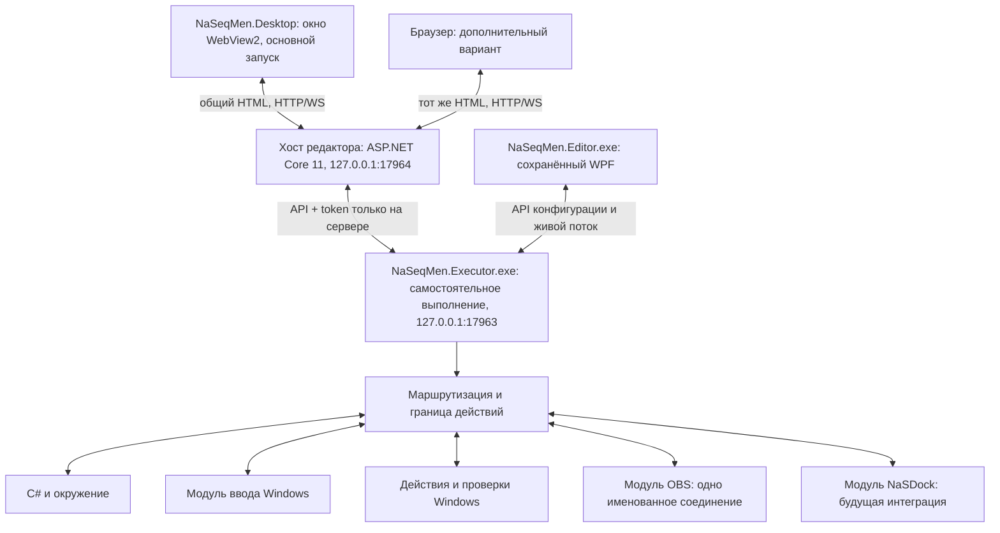
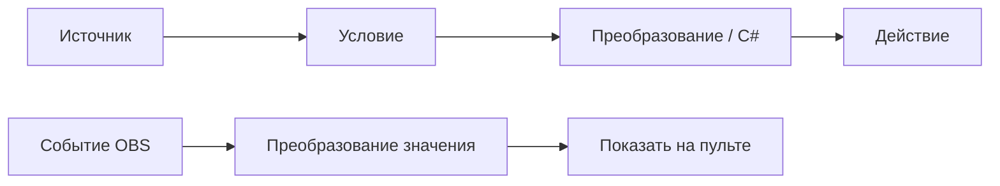

# Единая архитектура NaSeqMen

> Уточнение владельца 2026-11-15: текущее состояние удерживаемых клавиш, включая Shift/Ctrl/Alt/Win, разрешено для условий и обработки. Это узкое исключение из прежнего запрета состояний, без истории и дискового хранения. Контракт и текущая граница реализации: [состояние ввода](input-state.md).

Дата: 2026-11-15. Решения владельца — [требования](../REQUIREMENTS.md). Здесь соединены обсуждённые части, а не добавлена система хранения или отдельный язык автоматизации.

## Назначение

NaSeqMen связывает источники, условия, преобразования, C#-обработчики и действия. Мышь, клавиатура, NaSDock и внешняя программа равноправны как источники сообщений. Одно и то же соединение внешнего модуля может использоваться в обоих направлениях.

Сохраняется конфигурация: соединения, имена кнопок и сопоставления, узлы/связи, параметры и исходники сценариев. Данные внешнего мира не сохраняются: нет retained/latest value, API выдачи прошлого значения, снимков, восстановления событий или начальной синхронизации. Подключившийся получатель видит только дальнейшие сообщения. Явно настроенный запрос к внешней программе — обычное действие, а его ответ — обычное сообщение.

## Граница процессов

Текущий основной запуск — окно NaSeqMen.Desktop на .NET 11/WinForms с WebView2. В нём нет отдельной реализации экранов: HTML/CSS/JavaScript находятся в единственном исходном wwwroot проекта Editor.Web и включаются в пакет редактора. Серверный хост Editor.Web выделен в переиспользуемый WebEditorHost; окно запускает его в собственном процессе, если локальный сервер редактора ещё не работает. При уже запущенном проверенном сервере окно подключается к нему. Закрытие окна завершает только принадлежащий ему сервер; исполнитель и чужой экземпляр сервера не останавливаются.

Таким образом, HTML принадлежит редактору, а не исполнителю и не модулям. Исполнитель предоставляет конфигурацию, описания операций и новые события через API/WS. HTML отдаётся локальным сервером редактора на 127.0.0.1:17964, а запросы к исполнителю 17963 проходят через ограниченный прокси. В браузерном варианте этот же сервер запускается отдельным процессом. Файлы исходного шаблона на машине разработки не нужны установленному приложению. Обновление внешнего интерфейса не меняет маршрутизацию событий.

Оболочка адаптирована из UI.TechnicalShell без переноса на Blazor. Палитры, иконки и подсказки включены локально; детали — в [technical-shell.md](technical-shell.md). Старый WPF остаётся отдельным вариантом, не участвует в работе HTML-окна.

Исполнитель живёт в пользовательском сеансе, обслуживает устройства/соединения и работает без редактора. Редактор подключается и отключается независимо. Открытие редактора не является запуском правил, закрытие не останавливает их. На этапе альфы приложение не устанавливается в автозапуск или системную службу.

По прямому решению владельца новый редактор создаётся на HTML рядом с WPF, без удаления прежнего проекта. `NaSeqMen.Editor.Web` раздаёт локальные HTML/CSS/JavaScript и проксирует ограниченный API одного исполнителя. API-token остаётся на сервере; браузер обращается только к origin редактора. Веб-процесс не загружает рабочие модули, не компилирует C# и не создаёт вторую конфигурацию. Оба интерфейса сохраняют настройки через один API исполнителя. Текущая платформа проектов — .NET 11, SDK 11.0.100; установлен runtime 11.0.0.

Ввод не проходит через редактор. Медленная визуализация не тормозит исполнение: ограниченный живой диагностический канал может пропустить строки с явным индикатором пропуска. Диагностика не воспроизводится новому подписчику и не может быть источником схемы.

## Модель схемы

В UI источники слева, действия справа — последняя прямая поправка владельца. Все маршруты имеют одно направление; обратные сообщения внешней программы не превращают провод в двунаправленный. Промежуточные этапы необязательны. Несколько связей образуют ветвление; в первой альфе циклы запрещены.

| Элемент | Ответственность |
|---|---|
| Источник | Выдать конкретное поступившее событие/значение и идентичность источника |
| Условие | Пропустить либо остановить ветку; при проверке программы обратиться к Windows в момент обработки |
| Преобразование | Изменить данные текущего сообщения |
| C# | Обработать текущий вход в предоставленном окружении, вернуть выход либо завершить ветку |
| Действие | Сформировать вызов модуля; исполнитель выбирает реальный вызов или диагностическое подавление |

Метаданные сообщения дают связь с исходным поступлением и возможность подсветить маршрут. Нажатие и отпускание — самостоятельные события. Порядок исполнения внутри цепочки сохраняется. Побочные эффекты не повторяются автоматически после ошибки или переподключения.

## Модули и соединения

Модуль — отдельная сборка с общим контрактом: описание входов, действий и условий, подключение/отключение, вызовы и освобождение ресурсов. Ядро не знает команд OBS или особенностей конкретной мыши. Редактор получает описание параметров из контракта.

Соединение — настроенный экземпляр модуля с пользовательским именем. Пять действий OBS и два источника его событий используют одно выбранное соединение. Настройки подключения не дублируются по узлам. Разные OBS могут иметь разные экземпляры соединения.

В первой альфе Windows-действия и проверки программ объединены в один небольшой модуль. Это не делает их частью ядра. Расширение модулей не требует добавлять условные ветки в маршрутизатор.

## Ввод неизвестного устройства

Редактор показывает обнаруженные интерфейсы и живые сообщения, позволяет нажать кнопки, назвать их и сохранить сопоставления. Составная мышь может выдавать часть кнопок как клавиатуру. Не угадывать назначение по одной красивой картинке или названию модели.

Обнаружение переключается прямо в строках интерфейсов. Временная панель редактора создаёт одну кнопку на пару «интерфейс + код», обновляет её при следующих фазах и открывает технические подробности по запросу. Это представление текущего сеанса, не API последних значений и не источник данных для исполнения. Составные последовательности вроде Win+E автоматически не объединяются: режим обучения с подтверждением шаблона пока только обсуждён.

Политика Windows-ввода отдельна от маршрутизации: остановка ветки схемы не подавляет исходное нажатие для других приложений. Будущий backend подавления обязан объявить возможность явно. Первая альфа использует пассивный Raw Input, не подавляет ввод; попытка сохранить неподдерживаемую политику должна быть отклонена. Действующий KOE.ahk сохраняется как есть, его код не переносится.

## C# и пробный прогон

Простые действия выбираются в редакторе. Сложный обработчик пишется на C#, компилируется при проверке/применении и получает вход, параметры окружения, отмену, диагностический вывод и доступ к действиям модулей. Отдельный язык программирования не создаётся.

Пробный режим сохраняет путь сообщения до сформированной команды, затем подавляет вызов выходного модуля. Он не подставляет успешный ответ внешней программы. Если следующий шаг зависит от реального ответа, такого ответа в пробном прогоне нет.

C# в альфе — доверенный локальный код, не sandbox. Гарантия подавления относится к действиям через API окружения. Прямые вызовы файлов, сети и Windows из произвольного C# находятся вне этой границы. Собственные примеры используют только окружение; исполнитель не объявляет произвольный C# безопасным.

## Редактор и диагностика

Окно свободно изменяет размер и разворачивается. Размер окна, масштаб схемы и читаемость текста не связываются с конкретной мышью. Списки — плотные сортируемые таблицы с фильтрами; параметры — компактные окна редактирования. Схема — явно запрошенные вертикальные полосы и контакты, не декоративная сетка карточек.

Для каждой цепочки видны вход, решение условия, преобразование и намерение действия. Узлы/провода подсвечиваются по поступлению. Подробности и текст ошибок открываются без баннеров, перекрытий и изменения геометрии. Ограниченная таблица диагностики существует только для просмотра текущего сеанса редактора.

В HTML-редакторе журнал следует за поступлением строк, пока просмотр стоит на последней записи. Прокрутка вверх останавливает автоматическое перемещение; возврат в конец включает его снова. Это локальное поведение просмотра, не изменение маршрутизации или хранения событий.

## Конкретизация первой альфы

Прямой текущий выбор владельца: .NET 11 и новый HTML-редактор рядом с сохранённым WPF. Loopback HTTP+WS, отдельные DLL-модули и Roslyn для C# остаются техническими решениями реализации. [Контракт API](alpha-contract.md) является общей точкой интеграции; [HTML-редактор](web-editor.md) описывает дополнительный локальный сервер.

Первая альфа должна доказать проход: синтетический/наблюдаемый вход → условие → преобразование или C# → намерение действия, а также независимость редактора. Отдельный portable OBS в C:\OBS служит тестовой программой. Перехват с подавлением, полная эмуляция старого AHK, физический USB NaSDock и готовый магазин модулей не заявляются готовыми.
